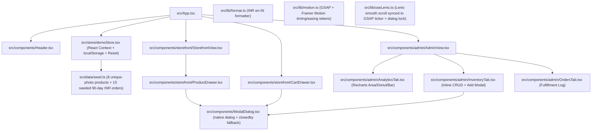

# GiftShop — Living Knowledge Graph (`KNOWLEDGE_GRAPH.md`)

> **Instant Sync Rule:** Every new file, route, store action, token change, or asset addition MUST update this file in the same task.

---

## 1. Project Identity & Status
* **Workspace:** `c:\Ecom Demo 2`
* **Stage:** Stage 6 Complete (Verified live in Brave across 1440px and 375px)
* **Mode:** Portfolio Demo (`GiftShop`)
* **Visual System:** `Direction B — Editorial Gallery` (see `docs/blueprint/DESIGN_SYSTEM.md`)

---

## 2. Implemented Module Graph

---

## 3. Core Data Entities (`src/types/shop.ts`)
* **`Department`**: `'Luxury Gift Boxes' | 'Personalized & Engraved' | 'Flowers, Plants & Hampers' | 'Home & Lifestyle'`
* **`Occasion`**: `'Birthday' | 'Anniversary' | 'Wedding' | 'Housewarming' | 'Thank You'`
* **`Product`**: `{ id, sku, name, department, occasion, price, stock, personalizable, image, description, featured? }`
* **`CartItem`**: `{ productId, qty, engraving }`
* **`OrderStatus`**: `'Pending' | 'Packed' | 'Shipped' | 'Delivered'`
* **`Order`**: `{ id, customer, createdAtDaysAgo, status, giftWrap, giftNote, items[], total }`

---

## 4. Key Architectural & Operator Constraints
1. **No Backend / Pure Client Engine:** `localStorage` key `giftshop_demo_v1` with 1-click Reset Demo Data so every portfolio visitor gets an isolated, fast sandbox.
2. **Real Editorial Photography:** Product images live in `public/images/` (copied from verified generated studio photos) and load with zero external hotlink fragility.
3. **Icons:** `@phosphor-icons/react` exclusively (`light` on Storefront, `regular` on Admin).
4. **Anti-Slop / User Preferences:**
   * Zero pulsing dots or *"Live stock/database sync"* AI phrasing.
   * Zero eyebrows/tracked uppercase labels, zero middle-dot meta, zero emojis.
   * INR (`₹`) formatted via `Intl.NumberFormat('en-IN')`.
5. **Cloudflare Workers Ready:** `wrangler.jsonc` configured with `assets: { directory: "./dist", not_found_handling: "single-page-application" }` so `/assets/*` CSS/JS/images always serve with real MIME types.
6. **Live Verification Gate:** Before handoff, verify live app in **Brave** (`375px`, `1440px`, `1920px`) with `0` failed CSS/font/image requests (`status >= 400`) and visual screenshot inspection.
